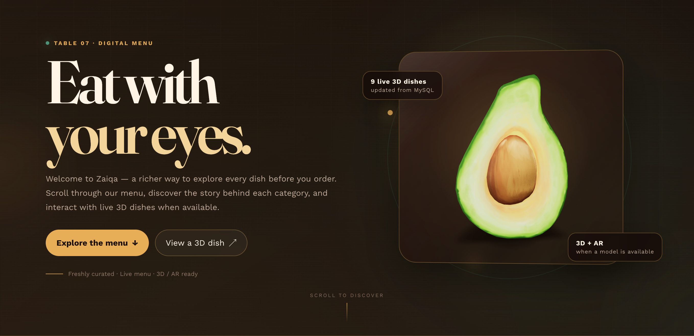
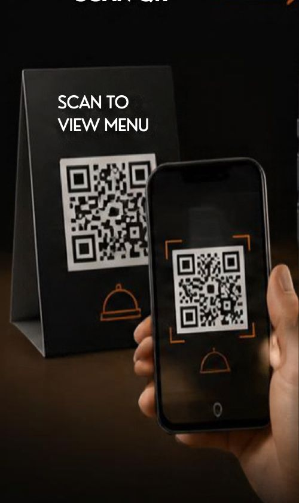
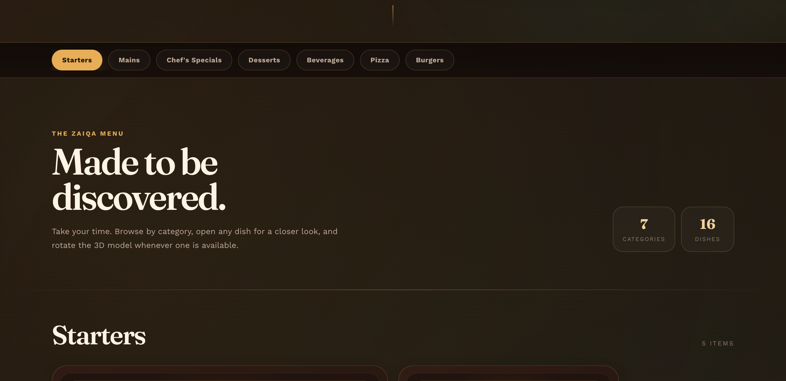
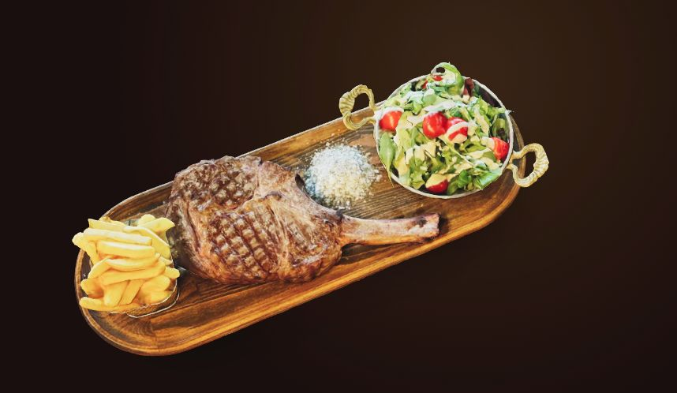
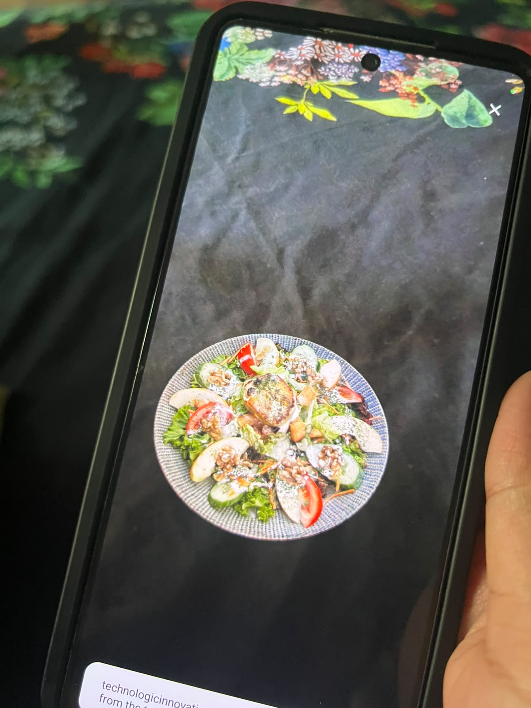
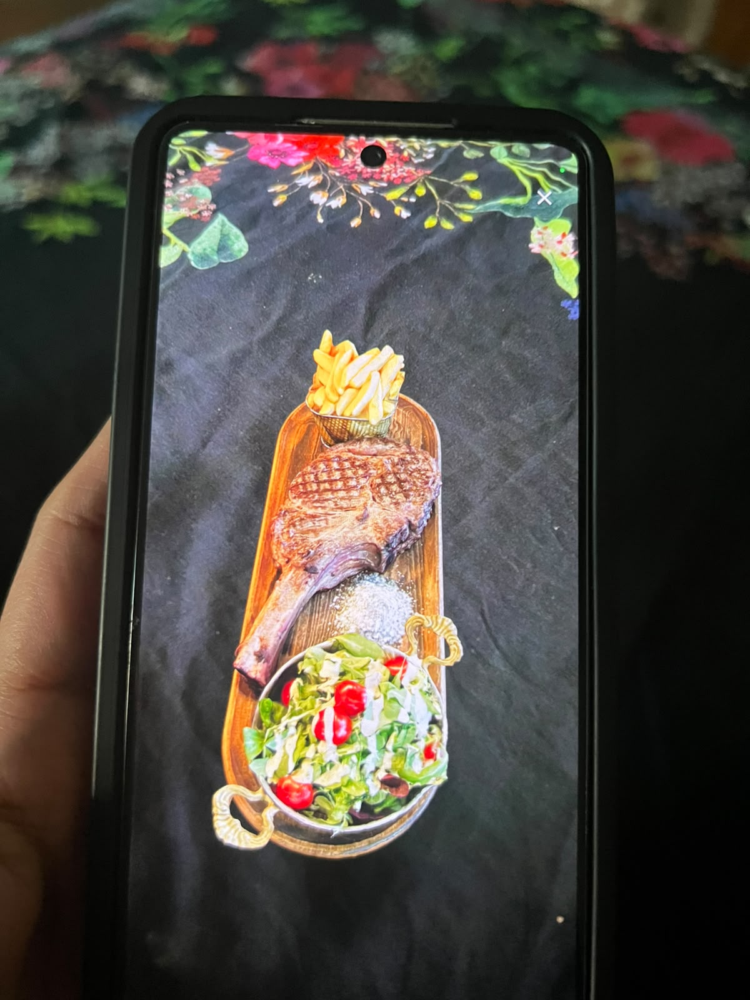
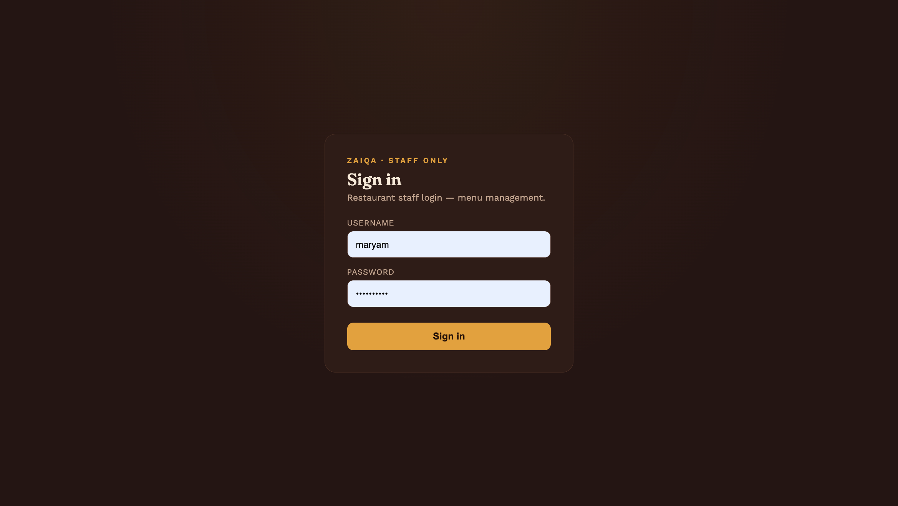
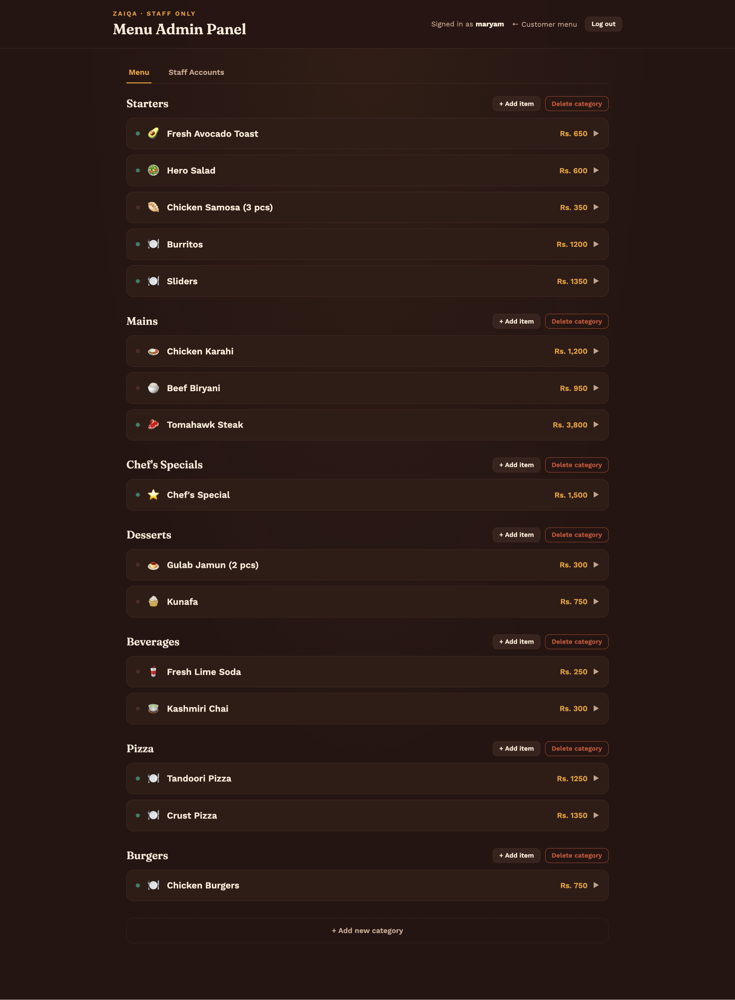
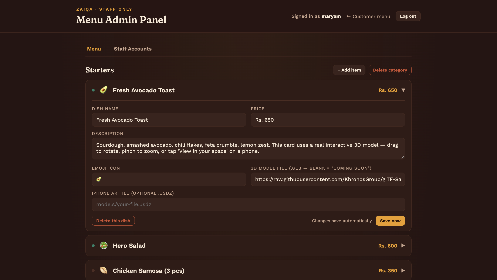

# 🍽️ Zaiqa — Live 3D & AR Digital Menu

<p align="center">
  <strong>
    A next-generation digital restaurant menu powered by 3D and Augmented Reality.
  </strong>
</p>

<p align="center">
  <a href="https://technologicinnovations.ltd/zaiqa/">
    
  </a>
</p>

---

<p align="center">
  
</p>

<p align="center">
  <em>
    Explore restaurant dishes through an interactive digital menu, 3D models, and Augmented Reality.
  </em>
</p>

---

## ✨ What is Zaiqa?

**Zaiqa** transforms the traditional restaurant menu into an interactive **3D and AR digital dining experience**.

Customers simply scan a QR code at their table and instantly access the restaurant's live menu without installing a mobile application.

The menu retrieves its content dynamically from a MySQL database, while supported dishes can be explored through interactive 3D models and Augmented Reality.

### The experience

```text
QR Code
   ↓
Live Digital Menu
   ↓
Browse Categories & Dishes
   ↓
Explore Interactive 3D
   ↓
View Dish in Your Space
```

---

# 📱 Customer Experience

## 01 — Scan

<p align="center">
  
</p>

Customers scan the QR code available at the restaurant table.

**No application installation required.**

---

## 02 — Browse

<p align="center">
  
</p>

Customers can browse:

- Categories
- Dishes
- Prices
- Descriptions
- Images
- Available 3D models
- Available AR models

The menu is dynamically loaded from the backend.

---

## 03 — Explore in 3D

<table>
<tr>
<td width="50%">

<p align="center">
  
</p>

### 🧊 Interactive 3D

Customers can:

- Rotate dishes
- Zoom in and out
- Inspect presentation
- View dishes from different angles
- Interact with models directly in the browser

</td>

<td width="50%">

<p align="center">
  
</p>

### 📱 Augmented Reality

Supported mobile devices can launch an AR experience and preview the dish in the customer's physical environment.

</td>
</tr>
</table>

---

## 04 — View in Your Space

<p align="center">
  
</p>

On supported devices, customers can select:

> **View in your space**

The dish can then be previewed on a real table or another physical surface.

### Android

Supports:

- `.glb`
- WebXR
- Scene Viewer

### iOS

Can optionally use:

- `.usdz`
- Apple Quick Look

AR availability depends on the device, browser, model format, and deployment environment.

---

# 🔐 Restaurant Admin Dashboard

Zaiqa is not only a customer-facing menu.

It also includes a dedicated administration system for restaurant staff.

<p align="center">
  
</p>

### Secure staff login

The administration area uses a separate login system that is not exposed through the public customer menu.

---

<p align="center">
  
</p>

### Dashboard

Restaurant staff can manage the restaurant's menu through the administration interface.

### Staff can manage

- Categories
- Dishes
- Prices
- Descriptions
- Images
- 3D model paths
- AR model paths
- Staff accounts

---

<p align="center">
  
</p>

### Dynamic menu management

Changes made by staff are stored in MySQL and become available to the customer-facing menu without requiring frontend code changes.

---

# 🚀 Key Features

| Feature | Description |
|---|---|
| 📱 QR Menu | Customers access the menu by scanning a table QR code |
| 🧊 Interactive 3D | Rotate, zoom, and inspect dishes |
| 📲 Augmented Reality | Preview supported dishes in the physical environment |
| 🗄️ Live Database | Menu content is dynamically loaded from MySQL |
| 🔐 Admin Dashboard | Staff can manage restaurant content |
| 👥 Staff Accounts | Multiple staff accounts can be managed |
| 📦 3D Models | `.glb` model support |
| 🍎 iOS AR | Optional `.usdz` / Quick Look support |
| 📱 Responsive UI | Designed for mobile, tablet, and desktop |
| 🎨 Modern Interface | Animated and interactive restaurant experience |

---

# 🏗️ System Architecture

```text
                         Customer
                            │
                            │ QR Code
                            ▼
                  ┌─────────────────────┐
                  │   Zaiqa Web Menu    │
                  │   HTML / CSS / JS   │
                  └──────────┬──────────┘
                             │
                             │ HTTP Request
                             ▼
                  ┌─────────────────────┐
                  │     PHP Backend     │
                  │        + PDO        │
                  └──────────┬──────────┘
                             │
                             │ SQL Queries
                             ▼
                  ┌─────────────────────┐
                  │       MySQL         │
                  │                     │
                  │ Categories          │
                  │ Dishes              │
                  │ Prices              │
                  │ Descriptions        │
                  │ Model Paths         │
                  │ Staff Accounts      │
                  └──────────┬──────────┘
                             │
                  ┌──────────┴──────────┐
                  │                     │
                  ▼                     ▼
           ┌──────────────┐      ┌──────────────┐
           │ 3D Viewer    │      │  AR Viewer   │
           │    .glb      │      │ .glb / .usdz │
           └──────────────┘      └──────────────┘
```

---

# 🔄 How Zaiqa Works

## 1. Restaurant Staff

Staff members log into the administration dashboard.

They can create or modify:

```text
Category
   │
   └── Dish
        ├── Name
        ├── Description
        ├── Price
        ├── Image
        ├── GLB Model
        └── USDZ Model
```

The information is stored in MySQL.

---

## 2. Customer Scans QR Code

The customer scans the QR code located at the restaurant table.

```text
QR Code
   ↓
Browser
   ↓
Zaiqa Menu
```

No application installation is required.

---

## 3. Menu Loads From Database

The frontend requests the latest menu information from the PHP backend.

The backend retrieves the relevant data from MySQL.

```text
Frontend
   ↓
PHP Backend
   ↓
PDO
   ↓
MySQL
   ↓
Menu Data
   ↓
Frontend
```

This allows restaurant staff to update menu content without modifying frontend code.

---

## 4. Customer Explores a Dish

When a dish has a 3D model:

```text
Dish
 ↓
3D Model Available
 ↓
Interactive 3D Viewer
```

When a model is not available:

```text
Dish
 ↓
No 3D Model
 ↓
"3D Coming Soon"
```

This prevents missing models from breaking the customer experience.

---

## 5. Customer Uses AR

On supported devices:

```text
View in Your Space
        ↓
Device Camera
        ↓
AR Environment
        ↓
3D Dish Placement
```

The customer can visually inspect how the dish could appear in their physical environment.

---

# 🛠️ Technology Stack

| Layer | Technology |
|---|---|
| Frontend | HTML5 |
| Styling | CSS3 |
| Client-side Logic | JavaScript |
| 3D / AR | Google `model-viewer` |
| 3D Rendering | WebGL |
| AR | WebXR / Scene Viewer / Quick Look |
| 3D Assets | `.glb` / `.usdz` |
| Backend | PHP |
| Database Access | PDO |
| Database | MySQL |
| Authentication | PHP Authentication + Password Hashing |
| Hosting | cPanel Shared Hosting |
| Deployment | HTTPS |

---

# 🧊 3D & AR Technology

Zaiqa uses Google's **`<model-viewer>`** component for browser-based 3D and AR functionality.

The same web application can provide different experiences depending on the user's device.

```text
                         Zaiqa
                           │
                           ▼
                     model-viewer
                           │
              ┌────────────┴────────────┐
              │                         │
              ▼                         ▼
          Desktop                    Mobile
              │                         │
              ▼                         ▼
      Interactive 3D             Interactive 3D
                                        │
                                        ▼
                                       AR
                              ┌─────────┴─────────┐
                              │                   │
                           Android              iOS
                              │                   │
                            .glb                .usdz
                              │                   │
                       Scene Viewer          Quick Look
```

### Supported model formats

**3D**

```text
.glb
```

**Android AR**

```text
.glb
WebXR
Scene Viewer
```

**iOS AR**

```text
.usdz
Quick Look
```

---

# 🗄️ Database

Zaiqa uses **MySQL** as its primary relational database.

The menu is database-driven rather than hard-coded into the frontend.

### Typical entities

```text
Categories
    │
    └──────< Dishes

Staff
    │
    └────── Authentication / Management
```

A dish can contain:

```text
Dish
├── ID
├── Category
├── Name
├── Description
├── Price
├── Image Path
├── GLB Model Path
├── USDZ Model Path
└── Created / Updated Information
```

This architecture allows restaurant staff to manage the menu without requiring developer intervention.

---

# 🔐 Security

Security considerations include:

- Password hashing
- Separate admin authentication
- Server-side authorization
- PDO-based database access
- Input validation
- Database-driven access control
- HTTPS deployment

Passwords are not intended to be stored as plain-text values.

The administration interface is intentionally separated from the public customer menu.

> Production deployments should use secure credentials, HTTPS, proper authorization, and environment-specific configuration.

---

# 📱 Responsive Design

Zaiqa is designed around the QR-code restaurant experience.

The interface supports:

- Mobile phones
- Tablets
- Desktop browsers

The layout adapts to different screen sizes so customers can comfortably browse the menu after scanning a table QR code.

---

# 🎨 User Experience

The interface includes:

- Smooth scrolling
- Category navigation
- Interactive dish cards
- Dish detail views
- 3D model interaction
- AR launch controls
- Responsive layouts
- Animated UI elements

The goal is to make the digital menu feel like a modern restaurant product rather than a traditional static webpage.

---

# 📂 Project Structure

```text
zaiqa/
│
├── index.php
│
├── admin/
│   ├── login.php
│   ├── dashboard.php
│   ├── categories/
│   ├── dishes/
│   └── staff/
│
├── api/
│   ├── menu.php
│   ├── categories.php
│   └── dishes.php
│
├── config/
│   └── database.php
│
├── includes/
│   ├── auth.php
│   ├── header.php
│   └── footer.php
│
├── assets/
│   ├── css/
│   ├── js/
│   ├── images/
│   └── models/
│       ├── glb/
│       └── usdz/
│
├── database/
│   └── schema.sql
│
├── docs/
│   └── screenshots/
│
└── README.md
```

> Adjust this structure to match the actual repository structure if your implementation differs.

---

# 🚀 Getting Started

## Requirements

For local development:

- PHP 8+
- MySQL 8+ or compatible MySQL/MariaDB
- Apache or another PHP-compatible web server
- Modern web browser
- HTTPS for production AR functionality

---

## 1. Clone the Repository

```bash
git clone https://github.com/YOUR_USERNAME/zaiqa.git
cd zaiqa
```

---

## 2. Configure MySQL

Create the database:

```sql
CREATE DATABASE zaiqa;
```

Import the database schema:

```bash
mysql -u YOUR_USERNAME -p zaiqa < database/schema.sql
```

---

## 3. Configure Database Connection

Configure:

```text
Database Host
Database Name
Database Username
Database Password
```

Do not commit production database credentials to GitHub.

---

## 4. Start the Application

For a simple PHP development server:

```bash
php -S localhost:8000
```

Then open:

```text
http://localhost:8000
```

---

# 📱 AR Requirements

AR functionality depends on browser and device support.

For production deployment:

- Use HTTPS
- Provide valid `.glb` models
- Provide `.usdz` models where required for iOS
- Test AR on physical devices
- Ensure model files are accessible from the deployed domain

Desktop browsers can still use the interactive 3D viewer when AR is unavailable.

---

# 🎯 Use Cases

Zaiqa can be used by:

- Restaurants
- Cafés
- Hotels
- Food courts
- Cloud kitchens
- Fine-dining establishments
- Dessert shops
- Bakeries
- Catering businesses

The platform is particularly useful for restaurants where **visual presentation and portion perception** are important.

---

# 💡 Why 3D + AR for Food Menus?

Traditional menus usually provide:

```text
Dish Name
    +
Description
    +
Price
    +
Photo
```

Zaiqa adds another dimension:

```text
Dish Name
    +
Description
    +
Price
    +
Photo
    +
Interactive 3D
    +
Augmented Reality
```

Customers can inspect a dish from multiple angles and, on supported devices, preview it within their own physical environment.

---

# 📊 Project Highlights

## Database Engineering

- Dynamic MySQL-backed menu
- Relational data model
- CRUD operations
- Staff management
- Database-driven content
- Server-side data retrieval

## Backend Engineering

- PHP backend
- PDO database access
- Authentication
- Administrative CRUD operations
- Dynamic API/data loading

## Frontend Engineering

- Responsive UI
- JavaScript interactions
- Dynamic category navigation
- Interactive dish details
- 3D model integration
- AR integration

## 3D / AR

- `.glb` model support
- `.usdz` model support
- WebGL-based 3D rendering
- WebXR support where available
- Android Scene Viewer
- iOS Quick Look

---

# 🧪 Testing Checklist

Before deploying a restaurant menu:

```text
[ ] Customer menu loads
[ ] Categories load correctly
[ ] Dishes load correctly
[ ] Prices display correctly
[ ] Dish descriptions display correctly
[ ] Missing 3D models show fallback state
[ ] GLB models load correctly
[ ] 3D rotation works
[ ] 3D zoom works
[ ] AR works on supported Android devices
[ ] USDZ works on supported iOS devices
[ ] Admin login works
[ ] Invalid login is rejected
[ ] Staff permissions work
[ ] Category CRUD works
[ ] Dish CRUD works
[ ] Staff management works
[ ] Database connection works
[ ] HTTPS is enabled in production
```

---

# 🔮 Future Roadmap

## Phase 1 — Digital Ordering

- [ ] Shopping cart
- [ ] Add-to-cart functionality
- [ ] Table identification
- [ ] Order placement
- [ ] Order tracking

## Phase 2 — Payments

- [ ] Online payment integration
- [ ] Payment verification
- [ ] Digital receipts
- [ ] Order history

## Phase 3 — Restaurant Operations

- [ ] Kitchen dashboard
- [ ] Order management
- [ ] Real-time order status
- [ ] Staff roles and permissions
- [ ] Sales analytics

## Phase 4 — Mobile Applications

Explore wrapping the existing web application using:

- Capacitor
- Android
- iOS

The goal is to reuse the existing web codebase while providing native application capabilities.

## Phase 5 — Multi-Restaurant Platform

Potential architecture:

```text
Platform
│
├── Restaurant A
│   ├── Branch 1
│   └── Branch 2
│
├── Restaurant B
│   ├── Branch 1
│   └── Branch 2
│
└── Restaurant C
```

This could transform Zaiqa from a single restaurant menu into a multi-tenant restaurant platform.

## Phase 6 — Advanced Visual Experiences

Future experiments may include:

- Hologram pyramid displays
- Fan-based holographic displays
- Large in-store 3D displays
- Interactive restaurant kiosks

---

# 🌐 Live Demo

Experience the deployed version of Zaiqa:

**[Open Zaiqa Live Demo](https://technologicinnovations.ltd/zaiqa/)**

---

# 📸 Project Screenshots

The primary screenshots are intentionally displayed throughout this README so visitors can see the product while reading about its functionality.

Screenshot assets are maintained in:

```text
docs/screenshots/
├── hero.png
├── qr-menu.jpeg
├── menu.png
├── 3d-viewer.jpeg
├── ar-preview.jpeg
├── ar-preview2.jpeg
├── admin-login.png
├── admin-dashboard.png
└── dish-management.png
```

---

# 📚 Learning & Engineering Areas

This project demonstrates practical experience with:

```text
Web Development
      │
      ├── HTML
      ├── CSS
      └── JavaScript
             │
             ▼
Backend Engineering
      │
      ├── PHP
      ├── PDO
      └── Authentication
             │
             ▼
Database Engineering
      │
      └── MySQL
             │
             ▼
3D Web Development
      │
      ├── WebGL
      └── model-viewer
             │
             ▼
Augmented Reality
      │
      ├── WebXR
      ├── Scene Viewer
      └── Quick Look
```

---

# 🤝 Contributing

Contributions, ideas, and improvements are welcome.

Typical workflow:

```bash
git clone <repository>
git checkout -b feature/your-feature
```

Make your changes, test them, and submit a pull request.

---

# 📄 License

Add the license appropriate for your project.

If this is a proprietary client or business project, do not add an open-source license without confirming that the project owner permits it.

---

# 👩‍💻 Author

**Maryam Abdul Karim**

AI Engineer | Machine Learning | AI Agents | RAG | Python | Django

Interested in building intelligent systems that combine:

**AI + Software Engineering + Data + Real-World Applications**

---

<p align="center">
  <strong>⭐ If you find Zaiqa interesting, consider giving the repository a star.</strong>
</p>

<p align="center">
  Built with PHP, MySQL, JavaScript, 3D & Augmented Reality
</p>
